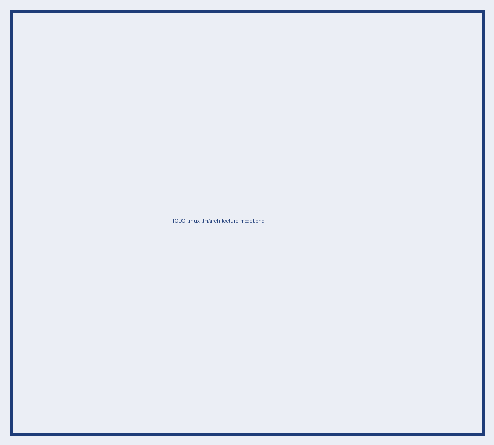
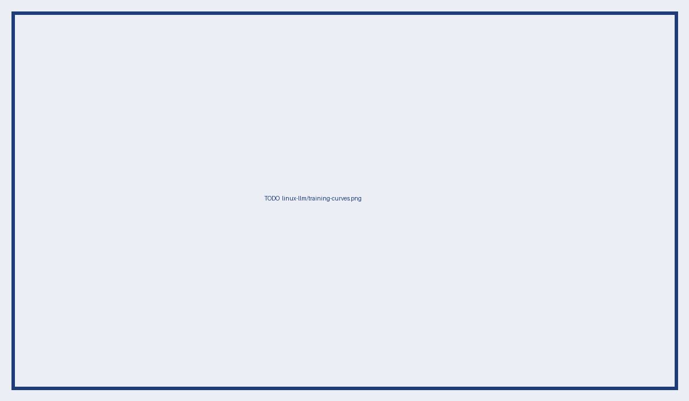

---
# ══════════════════════════════════════════════════════════════════
#  DECK — Small LLM for Linux commands. Built to LEARN by presenting.
#  One slide = one concept you must explain without notes.
#  "Must master" blocks are speaker notes (press S): your revision list.
#  Render: quarto render slides/linux-llm-deck.qmd
# ══════════════════════════════════════════════════════════════════
title: "A 500M LLM that runs Linux"
subtitle: "From-scratch decoder · distillation · LoRA · sandbox"
author: "Elyas Chikhaoui"
date: today
format:
  revealjs:
    theme: [default, ../styles.scss]
    slide-number: true
    transition: none
    width: 1280
    height: 720
    footer: "Elyas Chikhaoui — Linux LLM"
    lang: en
    code-line-numbers: true
---

# 1. Why

## The idea

- Natural-language request → shell command → executed in a sandbox → output fed back
- Small enough to run locally (500M params, 6 GB GPU)
- TODO: the one-line motivation

::: {.notes}
Must master: why local/small (cost, latency, privacy, control); what you give up vs a frontier model.
:::

## Constraints

- RTX 2060, 6 GB VRAM → every design choice below
- TODO: time budget, data budget

# 2. The model

## Decoder-only transformer

{width=70%}

::: {.notes}
Must master: draw the block at the whiteboard: embeddings → N×(LN → attn → +res → LN → MLP → +res) → LN → head. Shapes at each step for B×T×C.
:::

## Attention

$$\mathrm{Attn}(Q,K,V)=\mathrm{softmax}\!\left(\frac{QK^{\top}}{\sqrt{d_k}}+M\right)V$$

- Causal mask $M$, $h$ heads of dim $C/h$
- TODO: your `CausalSelfAttention` (10 lines max)

::: {.notes}
Must master: why $\sqrt{d_k}$; why multi-head; $O(T^2)$ memory; what a KV cache stores and why it makes generation $O(T)$ per token; flash-attention idea.
:::

## Hyperparameters

| | |
|---|---|
| Layers / hidden / heads | TODO |
| Params | ~500M |
| Vocab | 50 257 (BPE) |
| Context | 1 024 native; TODO used |

::: {.notes}
Must master: where the 500M comes from — count params per block ($12C^2$ approx.) + embeddings ($V\cdot C$).
:::

## Loading GPT-2 weights

- Name mapping checkpoint → my modules
- Conv1D → Linear: transpose `c_attn`, `c_proj`, `c_fc`, `c_proj`
- Sanity check: identical logits on a fixed prompt

::: {.notes}
Must master: why OpenAI used Conv1D (TF heritage); tied embeddings; what breaks if you forget the transpose (loss ≈ ln(50257)).
:::

## Tokenizer & context window

- GPT-2 BPE; special tokens: TODO
- Training length TODO, inference TODO
- Long stdout: truncation strategy TODO

::: {.notes}
Must master: BPE merges; why the same tokenizer as the pretrained weights is mandatory; how new tokens' embeddings are initialised.
:::

# 3. Distillation

## Teacher → student

- Teacher: TODO (size, how run)
- Type: sequence-level / logit-level / both — TODO
- Loss: TODO

::: {.notes}
Must master: Hinton 2015 soft targets and temperature; sequence-level KD (Kim & Rush 2016); why logit KD needs a shared vocabulary; what "dark knowledge" a 500M student can and cannot absorb.
:::

## Data generation & filtering

- Prompts to the teacher: TODO
- Execute-and-verify: keep only commands that run — TODO %
- Dedup, split — TODO

## The distilled dataset

- N examples, K task families — TODO
- Format — TODO

# 4. Fine-tuning

## Why LoRA: the VRAM arithmetic

| | fp32 full FT | LoRA r=TODO |
|---|---|---|
| Weights | 500M × 4 B = 2 GB | 2 GB (frozen, or 1 GB in bf16) |
| Gradients | 2 GB | ≈ 0 |
| Adam states | 4 GB | ≈ 0 |
| Activations | TODO | TODO |
| **Total** | > 8 GB ✗ | TODO GB ✓ |

::: {.notes}
Must master: this table cold. Mixed precision (bf16 weights, fp32 master copy) and loss scaling; gradient checkpointing trade-off.
:::

## LoRA

$$h = W_0 x + \frac{\alpha}{r} B A x,\quad A\in\mathbb{R}^{r\times d},\ B\in\mathbb{R}^{d\times r},\ B=0 \text{ at init}$$

- Target modules: TODO · rank TODO · α TODO
- Trainable: TODO % of params

::: {.notes}
Must master: why B=0 at init; why merge-able at inference (no latency); what rank controls; QLoRA difference; which modules matter most (attention vs MLP).
:::

## Training setup & curves

{width=70%}

- lr, schedule, batch × accumulation, steps — TODO
- Loss masking: only on command tokens? — TODO

# 5. Sandbox

## Isolation

- TODO: container / microVM / namespaces
- No network, read-only root, CPU/mem/time limits, allow-list
- Reset between tasks

::: {.notes}
Must master: namespaces vs cgroups vs seccomp; Docker is not a security boundary — why; gVisor / Firecracker in one sentence each.
:::

## The loop

request → prompt → command → guard → execute → truncated output → next turn / stop

- Stop condition, max turns — TODO
- Prompt injection through file contents — TODO

# 6. Results

## Execution-based evaluation

| Model | Task success | Valid syntax | Dangerous caught |
|---|---|---|---|
| GPT-2 base | TODO | TODO | TODO |
| Public corpora only | TODO | TODO | TODO |
| + distilled | TODO | TODO | TODO |
| Teacher | TODO | TODO | TODO |

::: {.notes}
Must master: why string match is wrong (`ls -la` vs `ls -al`); how the checker inspects sandbox state.
:::

## One success, one failure

TODO — a real transcript of each.

# 7. Takeaways

## What I learned

- TODO (3 max)

## Limits & next

- 1 024 context vs real sessions; 500M ceiling; sandbox not production-grade
- Next: TODO (RL from execution feedback? modern base?)
