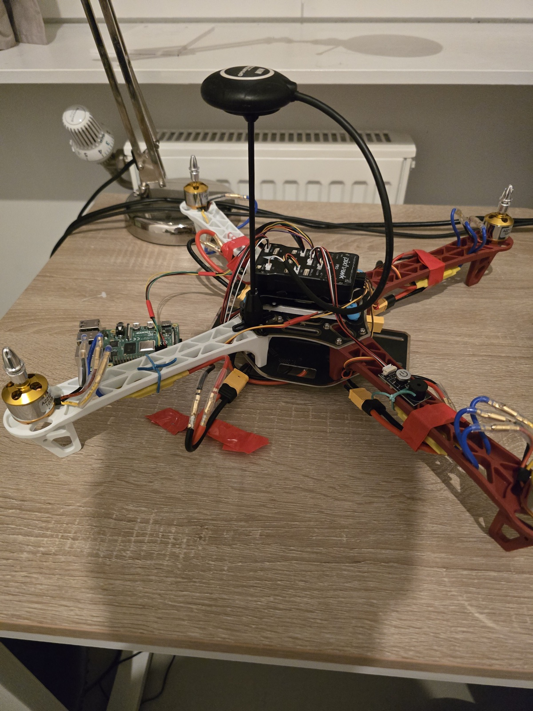
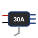
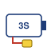
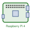
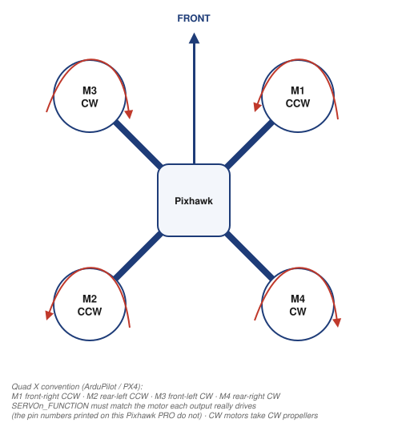
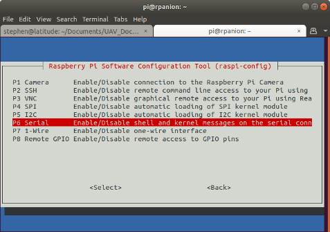
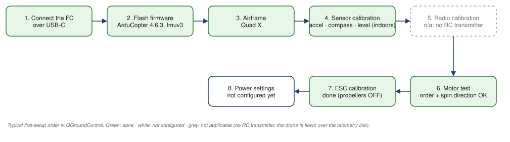

```{=html}
<style>/* this page: title only, no date line under it (the YAML date still orders the project cards) */
#title-block-header .date, #title-block-header .quarto-title-meta { display: none; }
.quarto-figure-center > figure > figcaption { text-align: center; }   /* captions centred under the centred figures */</style>
```

A quadcopter built from parts and flown from a laptop program over a 433 MHz telemetry link.

<!-- Diagrams: the system diagram and the icons are generated by assets/drone/diagrams/*.py (re-run after editing); the two remaining draw.io diagrams have their sources in assets/drone/diagrams/*.drawio. Weights marked "typ." are datasheet / listing figures, not measured. -->

{.lightbox width=85%}

## Hardware

| | Part | What it is | Qty | Price (€) | Where |
|---|---|---|---|---|---|
| {width=48} {width=48} {width=48} {width=48} {width=48} | **Pixhawk PRO kit** | Pixhawk PRO flight controller (STM32F4 @ 168 MHz, 2 MB flash, FMUv3-class, GH1.25 connectors, USB-C, 80 × 48 × 15 mm) + u-blox M8N GPS / compass with mast + PM02 V3.2 power module (2–12S, 5.2 V / 3 A, V/I sensing) + safety switch & buzzer + SiK telemetry radios V5 (433 MHz, 100 mW, ground + air) + cables + vibration mount | 1 kit | 143.99 | [AliExpress](https://fr.aliexpress.com/item/1005012560001551.html) |
| {width=48} | **F450 frame kit** | HAWK'S WORK F450: 450 mm wheelbase, glass-fibre and nylon, 2 white + 2 red arms, landing gear, pre-soldered bottom plate = power distribution board (MTOW ≈ 1.8 kg) | 1 | 37.99 | [Amazon](https://www.amazon.fr/dp/B09YQ4TM88) |
| {width=48} {width=48} {width=48} | **Motor + ESC + propeller sets** | each set: A2212 13T 1000KV brushless motor + 30 A SimonK ESC (5 V / 2 A BEC) + 2 propellers 1045 (so 4 spare propellers) | 4 sets | 4 × 18.99 = 75.96 | [Amazon](https://www.amazon.fr/dp/B081CW2928) |
| {width=48} | **Battery** | AMZZN LiPo 3S 11.1 V, 3000 mAh, 35C, XT60, with its USB charger | 1 | 34.99 | [Amazon](https://www.amazon.fr/dp/B0CY898G24) |
| {width=48} | **Raspberry Pi 4 Model B** | 2 GB, Raspberry Pi OS 32-bit on a 32 GB micro-SD card (25 €) | 1 | ≈ 65 + 25 | — |
| {width=48} | **Connectors and safety** | brass bullet connectors, crimped by hand — no soldering on this build (11.99) · 3 pairs of XT60 connectors (9.99) · 2 LiPo-safe charging bags (10.00) | | 31.98 | [bullets](https://www.amazon.fr/dp/B0B7FVQBW7) · [XT60](https://www.amazon.fr/dp/B0CF88BTYB) · [bags](https://www.amazon.fr/dp/B0F4XB3N71) |
| | **Total** | | | **≈ 415** | |

: {tbl-colwidths="[12,14,41,7,11,15]"}

<!-- No RC transmitter or receiver: the drone is flown from the Mac over the telemetry link (see Ground control). -->

::: {.callout-note collapse="true" appearance="simple" icon="false" title="Weight budget — typical values, to be replaced by the scale"}
| Part | Qty | Unit (g) | Total (g) | Source |
|---|---|---|---|---|
| F450 frame, incl. PDB plate | 1 | 282 | 282 | manufacturer spec |
| A2212 1000KV motor | 4 | ≈ 50 | ≈ 200 | typ. (listings: 47–56 g) |
| 30 A ESC | 4 | ≈ 25 | ≈ 100 | typ. |
| 1045 propeller | 4 | ≈ 13 | ≈ 52 | typ. |
| Pixhawk PRO | 1 | ≈ 38 | ≈ 38 | Pixhawk 2.4.8 figure |
| M8N GPS + mast | 1 | ≈ 50 | ≈ 50 | typ. |
| PM02 V3.2 | 1 | 20 | 20 | vendor spec |
| Safety switch + buzzer | 1 | ≈ 10 | ≈ 10 | typ. |
| Telemetry radio (air) + antenna | 1 | ≈ 20 | ≈ 20 | typ. |
| Raspberry Pi 4 B | 1 | 46 | 46 | Raspberry Pi spec |
| LiPo 3S 3000 mAh 35C | 1 | ≈ 240 | ≈ 240 | typ. (listings: 220–260 g) |
| Wiring, straps, misc. | | ≈ 40 | ≈ 40 | estimate |
| **All-up weight** | | | **≈ 1.1 kg** | estimate |
:::

## System overview and wiring

<!-- One diagram for the whole system: power chain (red), wiring to the real ports of the Pixhawk PRO and of the Pi's GPIO header (blue), wireless links (dashed) and the software on each machine (purple). On the site it is interactive: hover for details, click a part to highlight its connections, toggle layers, full screen. Source: assets/drone/diagrams/system_diagram.py. -->

::: {.content-visible when-format="html"}

:::

::: {.content-visible unless-format="html"}
{width=100%}
:::

{.lightbox width=55%}

::: {.callout-note collapse="true" appearance="simple" icon="false" title="Remarks"}
- **Power.** Battery (XT60) → PM02 power module (XT60 in/out) → F450 bottom plate, the power distribution board → the four ESCs, whose power leads end in brass bullet connectors crimped on the wires and mated to XT60 connectors → motors through crimped bullet connectors. The PM02's 6-pin lead feeds the Pixhawk's POWER port with 5.2 V plus battery voltage and current sensing. The Raspberry Pi is powered from the 5 V pin of the TELEM 2 connector, i.e. from the same 5.2 V rail.
- **Wiring.** ESC servo leads on MAIN OUT 1–4 (PWM). The `SERVOn_FUNCTION` parameters must match exactly which motor each output drives: on this board the numbers printed next to the MAIN OUT pins do not correspond to the firmware's outputs, which cost the first outdoor attempt (see *Known issue*). Raspberry Pi UART on TELEM 2: Pixhawk TX → Pi RX (GPIO 15, pin 10), Pixhawk RX → Pi TX (GPIO 14, pin 8), GND → GND (pin 6), 5 V → 5 V (pin 2). SiK air radio on TELEM 1. M8N GPS on the GPS port (UART) and its compass on I2C; safety switch on SWITCH, buzzer on BUZZER; laptop on USB-C for setup. No RC receiver: SBUS/RCIN is unused.
- **No soldering.** Motor and ESC leads are joined with brass bullet connectors crimped by hand, and the ESCs reach the plate through XT60 connectors; the plate came pre-soldered.
:::

## Raspberry Pi setup

<!-- Procedure followed from the ArduPilot wiki page "Communicating with Raspberry Pi via MAVLink". -->

The Pi's place in the system (UART pins, 5 V feed, TELEM 2, MAVProxy) is on the diagram above.

- **Board and OS.** Raspberry Pi 4 Model B (2 GB), Raspberry Pi OS 32-bit flashed on a micro-SD card, joined to a secured Wi-Fi network, administered over SSH.
- **Link.** The Pi's UART (`/dev/serial0`: GPIO 14 TXD on pin 8, GPIO 15 RXD on pin 10, GND on pin 6) is wired crosswise to the Pixhawk's **TELEM 2** port; MAVLink 2 at 57 600 baud. The connector's 5 V pin powers the Pi (pin 2).
- **Reference.** [ArduPilot wiki — Communicating with Raspberry Pi via MAVLink](https://ardupilot.org/dev/docs/raspberry-pi-via-mavlink.html).

**Flight-controller parameters** (set in QGroundControl):

| Parameter | Value | Effect |
|---|---|---|
| `SERIAL2_PROTOCOL` | 2 (MAVLink 2) | TELEM 2 talks MAVLink to the Pi |
| `SERIAL2_BAUD` | 57 (57 600 baud) | must match `--baudrate` on the Pi |

**1. Enable the UART on the Pi** with `sudo raspi-config` → *Interfacing Options* → *Serial*, then answer **No** to the login shell over serial and **Yes** to the serial port hardware, and reboot: the UART is then available as `/dev/serial0`.

::: {layout-ncol=2}
{.lightbox}

{.lightbox}
:::

Screenshots from the [ArduPilot wiki](https://ardupilot.org/dev/docs/raspberry-pi-via-mavlink.html) (© ArduPilot Dev Team, CC BY-SA 3.0).

**2. Packages and a virtual environment for pymavlink / MAVProxy:**

```bash
sudo apt-get update
sudo apt-get install python3-wxgtk4.0 python3-matplotlib python3-opencv python3-pip \
                     python3-numpy libxml2-dev libxslt1-dev python3-dev
sudo apt install python3-venv python3-full     # pip needs a venv on recent Raspberry Pi OS
mkdir ~/mavlink_project && cd ~/mavlink_project
python3 -m venv venv
source venv/bin/activate
pip install pymavlink
pip install mavproxy
```

**3. Start the link** (the same commands every session, by hand over SSH — not a boot service yet):

```bash
cd ~/mavlink_project && source venv/bin/activate
mavproxy.py --master=/dev/serial0 --baudrate 57600 --aircraft MyCopter
```

MAVProxy connects to the Pixhawk and shows the vehicle's heartbeat; `--aircraft MyCopter` keeps its logs in a `MyCopter/` folder. Nothing else runs on the Pi yet; this link is what automated control from the Raspberry Pi will use later.

## QGroundControl setup

{.lightbox width=100%}

::: {.callout-note collapse="true" appearance="simple" icon="false" title="Notes"}
- **Firmware.** ArduPilot **ArduCopter 4.6.3**, fmuv3 build — the target for Pixhawk 1 / 2.4.8-class boards such as the Pixhawk PRO, as the board's documentation asks.
- **Airframe.** Quad X.
- **Calibrations.** Accelerometer, compass and level horizon in QGroundControl, ESCs following the [Pixhawk 4 + S500 build tutorial, part 4](https://www.youtube.com/watch?v=BNzeVGD8IZI) (Alex Fache). All of it was done indoors, on the 4th floor of a building: the level reference and the compass offsets may be off, and no GPS fix was possible.
- **Radio calibration.** The RC arming check was disabled so the drone can arm, and `FS_THR_ENABLE` (throttle / RC failsafe) set to 0.
- **Arming checks.** GPS removed from `ARMING_CHECK` (no fix indoors); `DISARM_DELAY` set to 0 (default 10 s) so the motors stop as soon as the program disarms.
- **Battery / power settings.** Not configured.
- **Yaw tuning attempts** (against the spin, see *Known issue*): `ATC_RAT_YAW_P` 0.18 → 0.35, `ATC_RAT_YAW_I` 0.018 → 0.05, `ATC_RAT_YAW_IMAX` 0.5 → 1, `MOT_YAW_HEADROOM` 200 → 400. No cure.
:::

## Ground control

There is no RC transmitter. The drone is flown from the Mac with [`mavcontrol.py`](https://github.com/how2222/pixhawk-drone/blob/main/mavcontrol.py), a Python + pygame keyboard controller built on pymavlink (repository: [how2222/pixhawk-drone](https://github.com/how2222/pixhawk-drone)), through the pair of SiK telemetry radios (433 MHz, 100 mW): the ground module plugs into the Mac over USB, the air module sits on TELEM 1. Flight modes tested: Stabilize and Alt Hold.

{.lightbox width=90%}

## Test flight

First lift-off indoors on 12 April 2026, in Stabilize then Alt Hold (video below). The drone arms, spins up and leaves the ground, but rotates strongly about its vertical axis in both modes, and in Stabilize it also drifts about 40 cm during the climb — so flights have stayed at ground level.

::: {.content-visible when-format="html"}
```{=html}
<video controls preload="metadata" playsinline poster="../assets/drone/flight-poster.jpg" width="360" height="640" style="max-width:100%;border-radius:6px;background:#000"><source src="../assets/drone/flight.mp4" type="video/mp4"></video>
```
:::

::: {.content-visible unless-format="html"}
Flight video (6 s, indoors): on the web version of this page, <https://how2222.github.io/portfolio/projects/drone.html>.
:::

### Known issue: yaw spin at take-off

**What was found and fixed so far.** The first outdoor attempt (early April 2026, in a forest clearing) failed with asymmetric thrust: the drone tilted instead of climbing. The cause was the board itself: the numbers printed next to the Pixhawk PRO's MAIN OUT pins do not match the outputs the firmware actually drives, so the ESCs, plugged in by following those numbers, were not on the motors the mixer expected. Remapping the `SERVOn_FUNCTION` parameters to the real wiring, recalibrating the ESCs and correcting the CW / CCW propellers got the drone to lift off (8–12 April). No motor was ever found damaged or weaker. **What was tried without success:** raising the yaw-rate gains (`ATC_RAT_YAW_P` 0.18 → 0.35, `I` 0.018 → 0.05, `IMAX` 0.5 → 1) and `MOT_YAW_HEADROOM` 200 → 400.

::: {.callout-note collapse="true" appearance="simple" icon="false" title="Hypotheses still open"}
1. **Output-to-motor mapping.** Check again, motor by motor, that each `SERVOn_FUNCTION` drives the motor the mixer expects.
2. **Control inputs.** `mavcontrol.py` only overrides the throttle; roll, pitch and yaw are never sent.
3. **Propellers.** CW / CCW and seating on each motor.
4. **Indoor calibrations.** Redo the compass and level calibrations outdoors.
5. **Yaw PID.** Back to the default gains, then read the flight logs.
:::

## Links

- ArduPilot references used for the wiring: [Pixhawk overview](https://ardupilot.org/copter/docs/common-pixhawk-overview.html) · [connecting ESCs and motors](https://ardupilot.org/copter/docs/connect-escs-and-motors.html).
- Repository: [how2222/pixhawk-drone](https://github.com/how2222/pixhawk-drone) — `mavcontrol.py` and the Raspberry Pi procedure.
