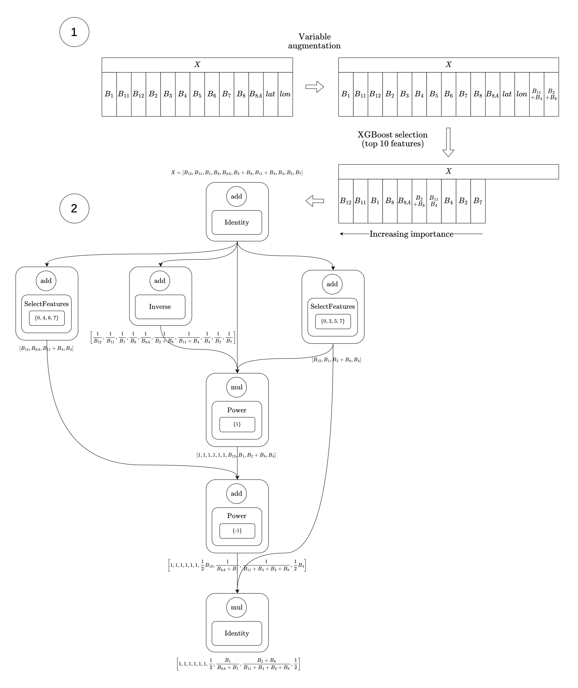

::: {.project-meta}
<dl>
<dt>Status</dt><dd></dd>
<dt>Role</dt><dd></dd>
<dt>Team</dt><dd></dd>
<dt>Duration</dt><dd></dd>
<dt>Context</dt><dd></dd>
<dt>Stack</dt><dd></dd>
</dl>
:::

::: {.pitch}
Symbolic regression searches for a closed-form equation that explains data, but tree-based genetic programming duplicates sub-expressions and degrades quickly under noise. DragonSR reformulates the search as the optimisation of a directed acyclic graph with multi-channel outputs; on 27 benchmark targets it matches or beats PySR on most noisy settings and on remote-sensing indices with 10+ input variables, where PySR recovers nothing above 0% noise.
:::

## Context

Symbolic regression (SR) sits between machine learning and scientific discovery: instead of fitting the parameters of a fixed model, it searches for both the *structure* of an equation and its constants. Most modern methods (gplearn, PySR, Operon) are genetic programming over expression trees; newer ones use reinforcement learning or LLM priors.

The starting point was DRAGON (Keisler et al., JMLR 2024), a neural architecture search framework that optimises the topology, operators and hyperparameters of a DAG with a bandit-driven evolutionary algorithm (Mutant-UCB). The research question of the internship: *can a NAS framework be repurposed to search over symbolic expressions instead of neural networks?* The applied motivation was Earth observation at INRIA: recovering spectral indices (NDVI, SAVI, …) from raw Sentinel-2 bands, i.e. noisy, multi-feature datasets that are unrepresentative of the small, clean SR benchmarks in the literature.

<!-- TODO (you): one honest sentence on what you could do at the start vs at the end. -->

## The technical problem

Given $\mathcal{D}=\{(x_i,y_i)\}$, find $f^\star=\arg\min_{f\in\mathcal{F}_{\mathcal{O},\mathcal{T}}} L(f,\mathcal{D})$ over the space of expressions built from operators $\mathcal{O}$ and terminals $\mathcal{T}$. Three things make this hard:

- **The search space is discrete, combinatorial and unbounded in size**, and every structure carries its own continuous constants to fit. Tree representations make it worse: $2x(x+x)$ forces a tree to recompute $x+x$ at every occurrence.
- **Noise.** Real measurements are noisy, and with thousands of samples the search must separate the analytical relationship from a heterogeneous cloud of points. PySR's recovery drops to 0/10 on every target as soon as 1% relative noise is added.
- **Dimensionality.** Remote-sensing targets have 13+ input bands; exhaustive or evolutionary search over all of them does not scale without feature selection.

## Approach & architecture

Expressions are DAGs whose nodes are `(combiner, primitive operator, parameters)`; edges carry *multi-channel* tensors, so several intermediate symbolic features propagate in parallel and a sub-expression is stored once and reused. The full pipeline, on a Sentinel-2 example:

{.lightbox width=62%}

Main components:

1. **Preprocessing** — optional Gaussian-process denoising of the target (Matérn kernel); *variable augmentation* (apply $\{+,-,\times,\div,\sqrt{\cdot},\log,|\cdot|,(\cdot)^{2},(\cdot)^{3},(\cdot)^{-1}\}$ to raw features, keep the best by $R^2$); XGBoost feature-importance ranking to retain the top-*n* features.
2. **Search space** — unary/binary primitives (powers $x^{k}, k\in\{\pm1,\pm2,\pm3\}$, ln, exp, sin, cos, sqrt, …), `add`/`mul` combiners with neutral-element padding, plus two *channel* operators: `SelectFeatures` (samples a channel subset with probability ∝ XGBoost importance) and `ChannelBoost` (adds a learned interaction channel).
3. **Search** — DRAGON's Mutant-UCB over increasing complexity levels, 10 000 evaluations, optional parallel streams each with its own operator subset (best loss wins).
4. **Objective** — MSE, MAE, Huber or $1-\rho_{\text{Pearson}}$ (affine-invariant, followed by an affine realignment), plus a composition penalty $\sum_{d_i\ge 2}(b^{d_i-1}-1)$ against nested $\sin(\sin(x))$-type chains; stochastic 10% subsampling per evaluation.
5. **Channel aggregation** — instead of taking the best single channel, combine channels with (a) sparse OLS with iterative thresholding, (b) *nested* OLS through a link function $f^{-1}(\sum_j w_j u_j(ch_j)+b)$, or (c) a polynomial-rational model linearised as $y(1+\sum b_m\phi_m)\approx a_0+\sum a_m\phi_m$ — all solved by linear least squares, no non-linear optimisation.

| Decision | Choice made | Alternative rejected | Why |
|---|---|---|---|
| Expression representation | DAG with shared sub-expressions and variable channel width | Expression tree (GP, DSR) | No duplicated sub-expressions; channel dimension becomes a search variable, so the space is richer at no extra budget |
| Search algorithm | Deterministic DAG optimisation with Mutant-UCB (inherited from DRAGON) | Evolutionary CGP, exhaustive DAG enumeration (Kahlmeyer et al.) | Reuses a mature NAS optimiser; complexity-level schedule bounds expression size |
| Constants | Extracted post hoc by (sparse / nested / rational) least squares on the output channels | Constants inside the genome, optimised per candidate (PySR) | Turns a non-linear constant search into a linear solve per candidate; the graph only has to find the *terms* |
| Search loss | Pearson correlation (+ affine realignment) as default | MSE / RMSE | Affine invariance: scale and offset are free, faster convergence (Haut et al. 2022, confirmed experimentally) |
| Noise handling | GPR surrogate target + stochastic subsampling | MC-dropout uncertainty weighting (explored, dropped) | Simpler, fewer hyperparameters, no extra network to train |
| Feature selection | Variable augmentation + XGBoost importance | Search directly over all raw bands | Makes 13-band Sentinel-2 problems tractable |

## My contribution

<!-- TODO (you): adjust attribution — the lines below are inferred from the paper; make explicit what came from Julie Keisler's DRAGON codebase vs what you wrote. -->

- Redesigned DRAGON's search space for symbolic regression: symbolic primitives, `add`/`mul` combiners with padding, and the two channel operators `SelectFeatures` and `ChannelBoost`.
- Designed and implemented the three channel-aggregation strategies (sparse OLS, nested OLS with link functions, polynomial-rational) and the composition-depth penalty.
- Built the preprocessing chain: variable augmentation, XGBoost ranking, GPR denoising, stochastic subsampling.
- Built the unified leaderboard pipeline (dataset generation with 6 000 samples, noise injection at ε ∈ {0, 1, 5, 10}%, 10 independent runs × 27 targets × 4 noise levels for both DragonSR and PySR), released on Zenodo.
- Wrote the paper as first author; explored and documented two directions that were not retained (MC-dropout weighting, IASI wet-bulb temperature retrieval).

## Results

Recovery counts over 10 independent runs, expression judged equivalent to ground truth after simplification. Selected rows from Table 2 of the paper:

| Target | PySR ε=0 | PySR ε≥0.01 | DragonSR ε=0 | ε=0.01 | ε=0.05 | ε=0.10 |
|---|---|---|---|---|---|---|
| Nguyen-8 ($\sqrt{x}$) | 10/10 | 0 | 9/10 | 10/10 | 9/10 | 8/10 |
| Nguyen-9 ($\sin x+\sin y^{2}$) | 0/10 | 0 | 10/10 | 9/10 | 8/10 | 8/10 |
| Hubble ($v=70d$) | 9/10 | 0 | 9/10 | 6/10 | 0/8 | 1/10 |
| Ideal gas ($V=nRT/P$) | 1/10 | 0 | 9/10 | 6/10 | 3/10 | 4/10 |
| Leavitt ($M=-2.81\log_{10}P-1.43$) | 2/10 | 0 | 10/10 | 6/10 | 7/10 | 5/10 |
| Kepler 3rd | 0/10 | 0 | 10/10 | 3/10 | 4/10 | 1/10 |
| SAVI (Sentinel-2) | 0/10 | 0 | 10/10 | 9/10 | 10/10 | 8/10 |
| EVI2 (Sentinel-2) | 0/10 | 0 | 9/10 | 8/10 | 3/10 | 3/10 |
| BSI (Sentinel-2) | 0/10 | 0 | 9/10 | 6/10 | 3/10 | 9/10 |
| AWEI_sh (Sentinel-2) | 8/10 | 0 | 10/10 | 3/10 | 1/10 | 0/10 |

Takeaways: PySR is strong on simple noiseless targets (N8, N10, N11 at 10/10) but recovers **nothing** at any noise level on any of the 27 targets; DragonSR degrades gracefully up to 10% noise and is the only method recovering the multi-variable remote-sensing indices. Both fail on targets needing precise constants or deep transcendental structure (Newton, Planck, Schechter, WI2015, BAI, VARI, NIRv).

Delivered: the paper (preprint), the open DragonSR code on GitHub, and the full run-level outputs on Zenodo.

## Links

- Paper: [PDF]() — *DragonSR: Directed Acyclic Graph Search for Equation Discovery*, Chikhaoui, Keisler, Charantonis, 2026 (arXiv to come)
- Code: []()
- Run-level data: []()

::: {.content-visible when-profile="prep"}

## Interview prep (private)

**Q — Why a DAG rather than a tree? Isn't Cartesian GP already doing that?**
A — Two reasons. First, sharing: a tree duplicates every repeated sub-expression, a DAG stores it once, which shrinks the space and the evaluation cost. Second, and specific to DragonSR, the channel dimension varies along the graph and becomes a search variable, so one candidate carries several partial expressions in parallel. CGP does share sub-expressions but evolves the topology with genetic operators; here the topology is optimised by a deterministic NAS procedure (Mutant-UCB) with a complexity schedule. The honest caveat: our results do not *prove* DAGs beat trees in general — no ablation isolates the representation.

**Q — How do you get the constants if the graph doesn't optimise them?**
A — The graph only has to produce the right *terms* as output channels; constants come from a linear solve afterwards. Sparse OLS with iterative thresholding gives $\hat y=\sum w_j ch_j+b$; nested OLS does the same in a link-transformed space ($\log$, $\sqrt{\cdot}$, inverse); the rational variant linearises $y(1+\sum b_m\phi_m)=a_0+\sum a_m\phi_m$. That converts a non-convex constant search into a least-squares problem. Cost: constants that sit *inside* a non-linearity, like $G$ in $Gm_1m_2/r^2$ with the huge magnitudes involved, are still hard — that's why Newton is 0/10.

**Q — PySR is the state of the art. Where exactly do you beat it, and where not?**
A — On noiseless simple Nguyen targets PySR wins (10/10 on N8/N10/N11). With any noise PySR recovers 0/10 everywhere in our protocol, DragonSR keeps e.g. 8/10 on N8 and N9 at 10% noise. On 13-band Sentinel-2 indices DragonSR recovers SAVI 10/10, EVI2 9/10, BSI 9/10 where PySR is 0/10. But the budgets are not matched in units, PySR was run at 2 000 iterations, and we used the same GPR denoiser for both, so I'd phrase it as "more robust to noise and dimensionality under our fixed budgets", not "better".

**Q — Why Pearson correlation as the loss?**
A — It is invariant to affine transforms of the prediction, so the search doesn't waste evaluations on scale and offset; those are recovered by a closed-form affine fit at the end. Haut et al. showed faster convergence than RMSE, and we observed the same. Downside: it can't distinguish $f$ from $af+b$, so it must be paired with the realignment, and it's blind to targets where scale is the whole point.

**Q — How do you keep expressions from bloating?**
A — Three mechanisms: the complexity-level schedule caps graph size (max 55) and explores small graphs first; the composition penalty $\sum(b^{d_i-1}-1)$ punishes chains like $\exp(\exp(x))$ exponentially in depth; sparse OLS thresholding drops channels with negligible weights. We still report only the lowest-loss candidate, not a Pareto front — a limitation.

**Q — Scale it to 50 or 500 input variables?**
A — Variable augmentation is quadratic in the number of features for binary operators, so it needs pruning; XGBoost top-*n* keeps the graph input small, and `SelectFeatures` samples ∝ importance. The IASI experiment (87 to thousands of channels, strongly correlated) is exactly where it broke: either huge expressions or inaccurate compact ones. I'd add a correlation-aware pre-selection and a hybrid symbolic + neural residual, which DRAGON's mixed search space allows in principle.

**Concepts to review:** genetic programming & PySR internals (Pareto front, mutation ops); Mutant-UCB / bandits with evolutionary operators; least squares, conditioning, ridge; Pearson vs MSE objectives; GP regression with Matérn kernels; XGBoost gain importance; SRBench and the Nguyen/Feynman suites; Sentinel-2 bands and the definition of NDVI/SAVI/EVI2/BSI; e-graphs (de França & Kronberger 2025); Kahlmeyer et al. 2025 exhaustive DAG search.

:::
